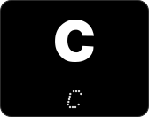
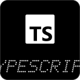
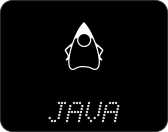
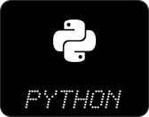
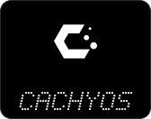
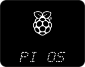
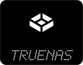
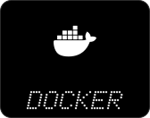
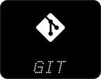
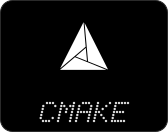

  

Student of **Applied Computer Science**, based in Germany.
Building things, learning across the stack.

  
  
  
  
  

  
  
  
  
  
  
  
  <!--  -->
  <!--  -->

_Nothing public yet. Projects will appear here once I make repos public._

<!--
Template for a project entry. Copy, fill in and uncomment:

**[Project name](https://github.com/MatteoKaul/repo-name)**
Short description of what it does.
`Python` `TypeScript`
-->

  
  

