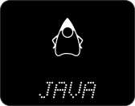
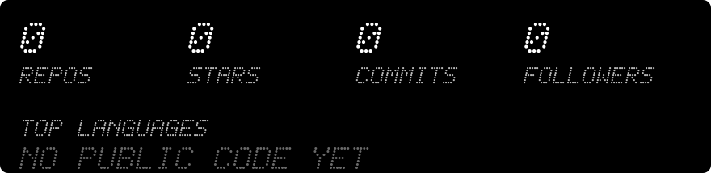

  

Student of **Applied Computer Science**, based in Germany.
Building things, learning across the stack.

<!-- icons:languages -->

  
  
  
  
  

<!-- /icons:languages -->

<!-- icons:systems -->

  
  
  
  
  
  
  

<!-- /icons:systems -->

_Nothing public yet. Projects will appear here once I make repos public._

<!--
Template for a project entry. Copy, fill in and uncomment:

**[Project name](https://github.com/MatteoKaul/repo-name)**
Short description of what it does.
`Python` `TypeScript`
-->

<!-- releases -->

<!-- /releases -->

