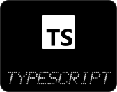
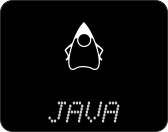
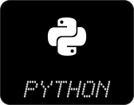
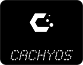
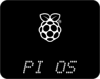
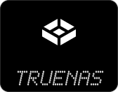
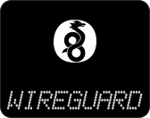
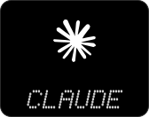

<!-- Generated by scripts/build.mjs from settings.txt. Edit settings.txt (or use editor/), not this file. -->

  

Student of **Applied Computer Science**, based in Germany.  
Building things, learning across the stack.

  
  
  
  
  

  
  
  
  
  

  

  

  

  

  

  

