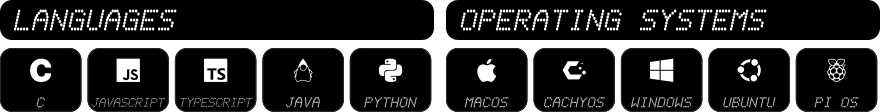

<!-- Generated by scripts/build.mjs from settings.txt. Edit settings.txt (editor: https://matteokaul.github.io/profile-matrix-config/), not this file. -->

  

Student of **Applied Computer Science**, based in Germany.  
Building things, learning across the stack.

